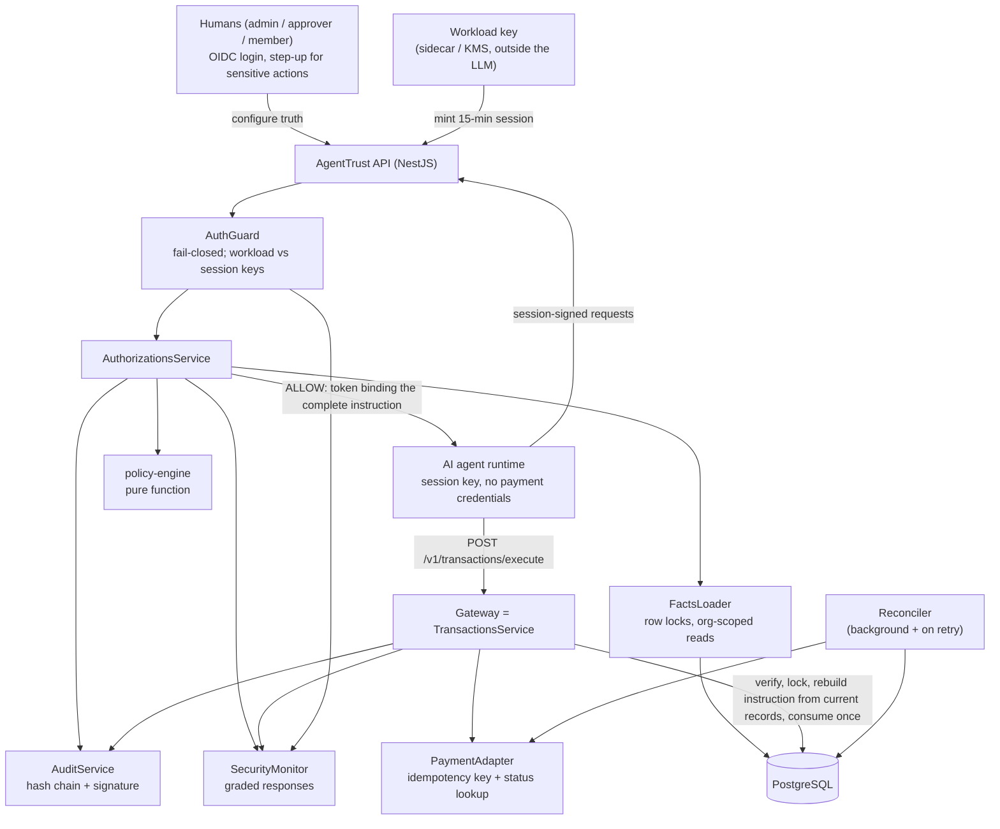
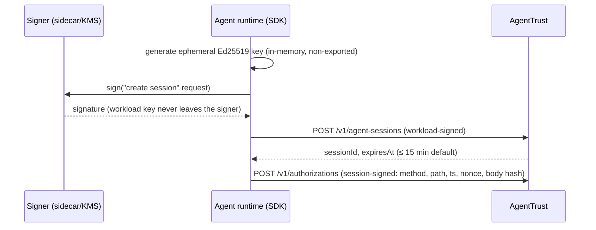
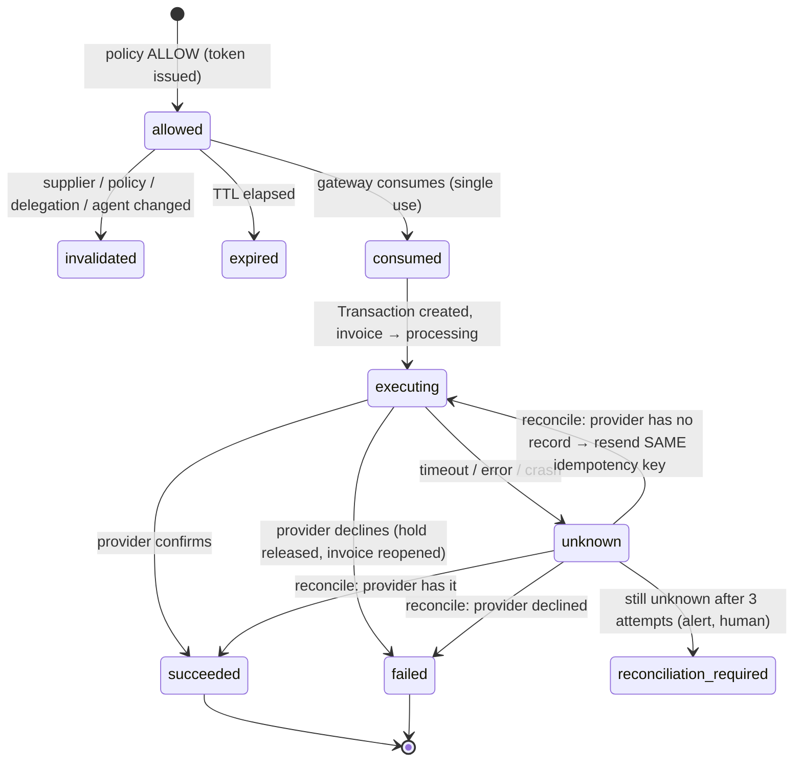

# Architecture

## Core principle: enforce at the payment boundary

AgentTrust doesn't try to guess whether an agent is behaving badly. It removes the agent's ability to move
money on its own **through the paths AgentTrust controls**. The agent can only **request** an authorization. A
deterministic engine checks the request against records humans control, and a gateway that alone holds payment
credentials **enforces** the decision and reconciles every uncertain outcome with the provider. Graded security
monitoring adds detection as a backstop.

> AgentTrust can only enforce what flows through its gateway. Customers must not give agents any other payment
> credential or tool.

## Components



| Component | Responsibility | Location |
|---|---|---|
| `AuthGuard` | Humans via bearer token; agents via signed requests. Workload credentials may only mint sessions; only session keys may authorize/pay. Replay-protected. Fail-closed. | `apps/api/src/auth/` |
| `SessionsController` | Mints short-lived session credentials; lists security alerts | `apps/api/src/auth/sessions.controller.ts` |
| `SuppliersController` | Versioned supplier records; step-up auth; dual-control verification with evidence; invalidation on change | `apps/api/src/suppliers/` |
| `FactsLoader` | Loads policy inputs from the DB inside a transaction with ordered row locks | `apps/api/src/authorizations/facts.loader.ts` |
| `policy-engine` | Pure, deterministic evaluation → decision + reason codes. No I/O, no AI. | `packages/policy-engine` |
| `AuthorizationsService` | Persists decisions, holds and evidence atomically; issues complete-binding tokens; approvals re-evaluate | `apps/api/src/authorizations/` |
| `invalidateLiveAuthorizations` | Kills live authorizations when supplier/policy/delegation/agent change | `apps/api/src/authorizations/invalidation.ts` |
| Gateway (`TransactionsService`) | Single enforcement point; payment state machine; reconciliation | `apps/api/src/transactions/` |
| `PaymentAdapter` | Provider boundary (sandbox with persisted ledger + fault injection) | `apps/api/src/transactions/payment-adapter.ts` |
| `ReconcilerService` | Background resolution of `executing`/`unknown` transactions | `apps/api/src/transactions/reconciler.service.ts` |
| `SecurityMonitorService` | Graded responses: suspend only on authenticated violations; alert otherwise | `apps/api/src/security/` |
| `AuditService` | Signed, hash-chained, append-only evidence per organization | `apps/api/src/audit/` |

## Agent identity



Cryptography proves *which credential* signed a request and that the payload wasn't altered. It does **not** prove
human intent. Intent comes from human-only records (delegations, POs, invoices, approvals) that the agent
can reference but never create or modify.

## Payment lifecycle and state machine



Rules:
- The attempt counter is persisted **before** each provider call; every call is logged (`TransactionAttempt`).
- Every provider call for a transaction uses the **same idempotency key** (the authorization id).
- Before any resend, the gateway **queries the provider** for the previous attempt.
- Outcomes apply **exactly once** (conditional updates); a lease prevents concurrent reconcilers.
- Retrying `execute` with a consumed authorization reconciles if non-final, otherwise returns `AUTHORIZATION_ALREADY_USED`.

## Complete payment binding

`authorizationFingerprint` (v2) = SHA-256 over canonical JSON of:
`organizationId, agentId, action, supplierId, supplierVersion, paymentRail, destinationRef,
paymentDestinationFingerprint, amountCents, currency, purchaseOrderId, invoiceId, policyId, policyVersion, delegationId`.

The token signs all of these. At execution the gateway **rebuilds the instruction from current records** and
rejects with a specific reason if anything differs.

## Key design decisions

1. Identity comes only from credentials. Strict schemas reject unknown fields.
2. The agent references; the server resolves. Agent-supplied payee details are compared, never trusted. The gateway
   pays the supplier's verified provider counterparty, never an agent-supplied destination.
3. **Lock order:** `Authorization → Agent → PurchaseOrder → Invoice → AuditChainHead`. Supplier changes lock
   `Supplier → Authorization(s) → AuditChainHead`. No transaction locks Authorization then Supplier.
4. Policies, delegations and supplier records are versioned/immutable grants. Authorizations bind exact versions.
5. Fail closed everywhere. Monitoring failures never change an authorization outcome.

See [ADR-0003](adr/0003-hardening.md) for the hardening decisions.

## v0.3: purchase-intent verification

```mermaid
flowchart LR
    U["Requester (human)"] -->|create| PI["Purchase instruction v1<br/>agent, supplier, PO, lines, uses, expiry"]
    ERP["ERP integration<br/>scope instructions:sync"] -->|sync (never implies approval)| PI
    A2["Approver (≠ requester, authority ≥ amount)"] -->|approve| PI
    R["Receiving clerk / ERP"] -->|receipt / completion| RC["Receipts"]
    AP["AP / ERP"] -->|invoice + lines| INV["Invoice"]
    AG["Agent (valid session)"] -->|reference ids only| ENG["Policy engine"]
    PI --> ENG
    RC --> ENG
    INV --> ENG
    ENG -->|ALLOW| TOK["Token binds instruction v + lines hash"]
```

- **Instruction ledger:** uses, amount and per-line quantities are tracked through budget reservations. Requests lock the
  instruction row, so concurrent requests can't over-consume it.
- **Lines precedence:** trusted invoice lines are used when present. Agent-supplied lines are used only otherwise, and a
  conflict is a DENY.
- **Finality:** see the payment lifecycle in [ADR-0004](adr/0004-purchase-intent-and-finality.md). Only `settled`
  marks an invoice paid.
- **Lock order:** `Authorization → Agent → PurchaseInstruction → PurchaseOrder → Invoice → AuditChainHead`. Change paths
  (supplier, instruction, delegation, policy, agent) lock live authorization rows first and write audit last.
- **Anchoring:** `AnchorService` writes signed Merkle roots to `ImmutableStorage`. `agenttrust-verify` checks an export
  against anchors read directly from storage.
