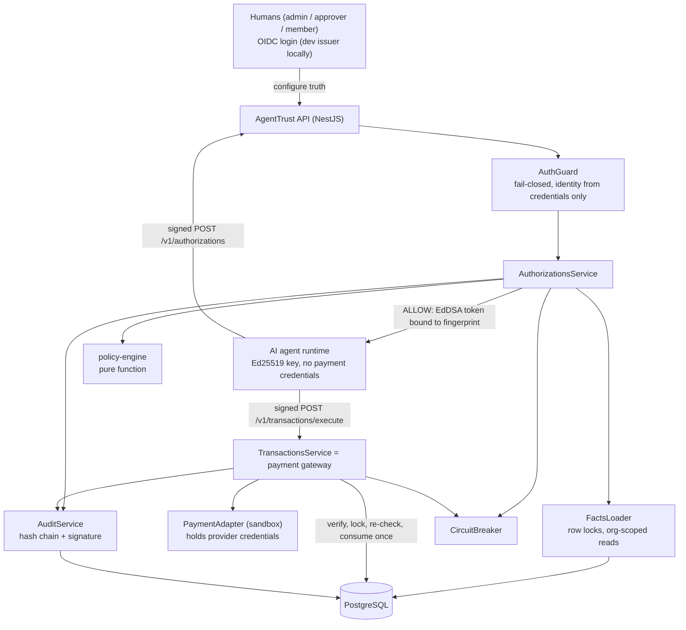

# Architecture

## Core principle: prevention, not detection

AgentTrust does not try to guess whether an agent is behaving badly. It removes the agent's ability to move
money on its own. The agent can only **request** an authorization; a deterministic engine checks the request
against records humans control; and a gateway that alone holds payment credentials **enforces** the decision.
A circuit breaker adds detection as a backstop.

## Components



| Component | Responsibility | Location |
|---|---|---|
| `AuthGuard` | Authenticates humans (bearer token) and agents (signed requests, replay-protected). Rejects routes without an access rule. | `apps/api/src/auth/` |
| `FactsLoader` | Loads every policy input from the database inside a transaction, taking row locks in a fixed order. | `apps/api/src/authorizations/facts.loader.ts` |
| `policy-engine` | Pure, deterministic evaluation → decision + reason codes. No I/O, no AI. | `packages/policy-engine` |
| `AuthorizationsService` | Persists decisions, budget holds and audit evidence atomically; issues tokens; handles approvals. | `apps/api/src/authorizations/` |
| Gateway (`TransactionsService`) | The single enforcement point for payment. | `apps/api/src/transactions/` |
| `PaymentAdapter` | Boundary to money movement; sandbox now, Stripe / Modern Treasury / banks later. | `apps/api/src/transactions/payment-adapter.ts` |
| `AuditService` | Signed, hash-chained, append-only evidence per organization. | `apps/api/src/audit/` |
| `CircuitBreakerService` | Suspends agents after N denials/rejections in a window. | `apps/api/src/authorizations/circuit-breaker.service.ts` |

## Request lifecycle

```mermaid
sequenceDiagram
    participant Agent
    participant API as AgentTrust API
    participant DB as PostgreSQL
    participant GW as Gateway
    participant PSP as Payment provider

    Agent->>API: POST /v1/authorizations (Ed25519-signed)
    API->>API: verify signature, timestamp, nonce
    API->>DB: BEGIN; lock Agent, PO, Invoice; load facts
    API->>API: evaluatePurchase(facts) → ALLOW
    API->>DB: insert Authorization + BudgetReservation + AuditEvent; COMMIT
    API-->>Agent: decision + reason codes + signed token (10 min, single use)
    Agent->>GW: POST /v1/transactions/execute (token + expected params, signed)
    GW->>GW: verify token signature, caller, exact params
    GW->>DB: BEGIN; lock Authorization; re-check agent, delegation, supplier bank, invoice
    GW->>DB: consume authorization, hold, invoice; insert Transaction(pending) + audit; COMMIT
    GW->>PSP: pay verified counterparty (idempotency key = authorization id)
    GW->>DB: Transaction succeeded/failed + audit
    GW-->>Agent: transaction result
```

## Key design decisions

1. **Identity comes only from credentials.** Organization and agent are derived from the verified request
   signature; strict schemas reject unknown body fields, so `organizationId` cannot be smuggled in.
2. **The agent references, the server resolves.** Requests carry IDs (supplier, PO, invoice) and the payee
   details the agent *intends* to pay. The server compares those against trusted records.
3. **Transaction fingerprint.** SHA-256 over canonical JSON of org, agent, supplier, payee fingerprint,
   amount, currency, PO and invoice. The authorization token signs this fingerprint and every field.
4. **Two independent payee checks.** The engine denies mismatched payees at authorization time; the gateway
   re-checks the supplier's *current* bank fingerprint at execution time and pays the supplier's verified
   counterparty, never an agent-supplied destination.
5. **Concurrency via PostgreSQL row locks.** Global lock order: `Authorization → Agent → PurchaseOrder →
   Invoice → AuditChainHead`. The Agent lock serializes one agent's spending decisions; PO and invoice locks
   protect shared capacity. A partial unique index guarantees one live hold per invoice.
6. **Two-phase execution.** Consumption commits before the provider call; the provider is called with the
   authorization id as idempotency key; a crash leaves a `pending` transaction for reconciliation and can
   never double-pay.
7. **Policies are immutable versions.** Every decision records the policy version that made it.
8. **Fail closed.** Missing policy, invalid stored rules, unknown keys, DB errors and exceptions all produce
   "not authorized".

See [ADRs](adr/) for the reasoning behind the stack and security choices.
