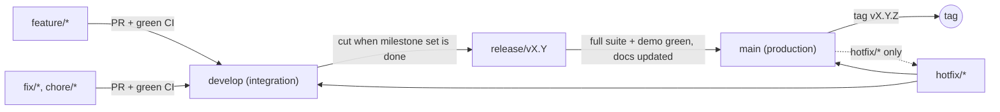

# Branching and Release Workflow

`main` is **production**. Nothing lands on `main` unless it is complete, fully tested, and released.

## Branches

| Branch | Purpose | Merges into | Rules |
|---|---|---|---|
| `main` | Production releases only | none | Protected. Merge only from `release/*` or `hotfix/*`. Every merge is tagged `vX.Y.Z`. No direct commits. |
| `develop` | Integration of finished features | `release/*` | Protected. Merge only via PR from `feature/*`, `fix/*`, `chore/*` with green CI. |
| `feature/<name>` | One feature / milestone | `develop` | Branch from `develop`. One milestone per branch. |
| `fix/<name>` | Non-urgent bug fix | `develop` | Branch from `develop`. |
| `chore/<name>` | Tooling, CI, docs | `develop` | Branch from `develop`. |
| `release/vX.Y` | Stabilize a release | `main` and back to `develop` | Only fixes, docs, version bumps. No new features. |
| `hotfix/<name>` | Urgent production fix | `main` and `develop` | Branch from `main`. |

## Rules for every branch

1. **Commit per completed milestone** (or logical step), with a descriptive message.
2. **Run the full suite before pushing**: `pnpm typecheck && pnpm test` (needs Postgres).
3. **Merge with `--no-ff`** so each feature stays visible in history.
4. **Security-critical test failures block merge** (CI must be green).
5. **Releases** additionally require: live demo passes (`pnpm demo`), docs updated (README, threat model, ADRs), and a tag.

## Recommended GitHub settings (repository admin)

Settings → Branches → add protection rules:

- `main`: require pull request, require status check **ci / test**, require linear history off (we use merge commits), restrict who can push, no force pushes, no deletions.
- `develop`: require pull request, require status check **ci / test**, no force pushes.

## History note

v0.2.0 (`5d9adb1`) was the last release built before this workflow existed. Milestones M1–M4 of v0.3 were pushed to `main` before the workflow was adopted; from M5 onward all work follows the branching rules, and v0.3 is formally released to `main` only through `release/v0.3`.
