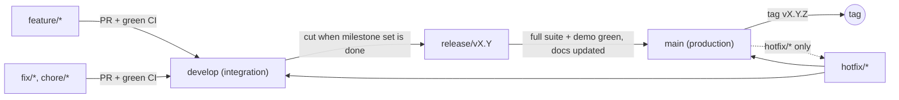

# Branching and Release Workflow

`main` is **production**. Nothing lands on `main` unless it is complete, fully tested, and released.



## Branches

| Branch | Purpose | Merges into | Rules |
|---|---|---|---|
| `main` | Production releases only | none | Protected. Merge only from `release/*` or `hotfix/*`. Every merge is tagged `vX.Y.Z`. No direct commits. |
| `develop` | Integration of finished features | `release/*` | Protected. Merge only via PR from `feature/*`, `fix/*`, `chore/*` with green CI. |
| `feature/<name>` | One feature / milestone | `develop` | Branch from `develop`. One milestone per branch. |
| `fix/<name>` | Non-urgent bug fix | `develop` | Branch from `develop`. |
| `chore/<name>` | Tooling, CI, docs | `develop` | Branch from `develop`. |
| `release/vX.Y` | Stabilize a release | `main` and back to `develop` | Only fixes, docs, version bumps. No new features. |
| `hotfix/<name>` | Urgent production fix | `main` and `develop` | Branch from `main`. |

## Rules for every branch

1. **Commit per completed milestone** (or logical step), with a descriptive message.
2. **Run the full suite before pushing**: `pnpm typecheck && pnpm test` (needs Postgres).
3. **Merge with `--no-ff`** so each feature stays visible in history.
4. **Security-critical test failures block merge** (CI must be green).
5. **Releases** additionally require: live demo passes (`pnpm demo`), docs updated (README, threat model, ADRs), and a tag.

## How changes land (pull requests)

From v0.4 onward every merge into `develop` or `main` goes through a GitHub pull request with green CI:

```bash
git push -u origin feature/<name>
gh pr create --base develop --fill            # feature/fix/chore → develop
gh pr checks --watch && gh pr merge --merge   # merge commit, never squash/rebase
```

Releases: `gh pr create --base main --head release/vX.Y`, merge after CI (including `main-source-guard`), then tag
`vX.Y.Z` on the merge commit and open a PR `main → develop` to bring release fixes back.

The local `pre-push` hook (`pnpm hooks:install`) blocks direct pushes to `main` and `develop`. Escape hatches
(`AGENTTRUST_RELEASE=1`, `AGENTTRUST_INTEGRATE=1`) exist only for when a PR genuinely cannot be used; using one must
be explained in the commit or PR description.

## Server-side protection (GitHub rulesets)

The local hook and CI's `main-source-guard` are useful but **bypassable** (a hook is opt-in per clone; a CI check
only matters if GitHub requires it). The real control is a server-side ruleset. Ours are versioned in
[`.github/rulesets/`](../.github/rulesets):

| Ruleset | Rules |
|---|---|
| [`main.json`](../.github/rulesets/main.json) | PR required (merge commits only, review threads resolved), required checks `test` + `main-source-guard` with branch up to date, no force pushes, no deletion, **no bypass actors** (admins included) |
| [`develop.json`](../.github/rulesets/develop.json) | PR required, required check `test`, no force pushes, no deletion, no bypass actors |

`main-source-guard` fails any PR into `main` whose head is not `release/*` or `hotfix/*`, so with the ruleset active
GitHub itself enforces "main only from release or hotfix branches".

Apply or update them with `scripts/apply-rulesets.sh` (needs `gh auth login` as a repo admin).
`required_approving_review_count` is 0 because there is one maintainer and GitHub does not let an author approve
their own PR; raise it to 1 as soon as there is a second engineer.

> **Status (v0.4): not enforced.** The repository is private and owned by a personal account on GitHub Free, where
> GitHub does not enforce rulesets. Decision: defer server-side protection and rely on the local hook + CI until the
> account moves to GitHub Pro (or the repo to a Team organization / public visibility). Then run
> `scripts/apply-rulesets.sh`, which also prints the rules GitHub reports as active, as evidence.

## History note (documented exception)

v0.2.0 (`5d9adb1`) was the last release built before this workflow existed. Milestones M1–M4 of v0.3
(`ccd119d`, `209ebf1`, `4a1e3c0`, `01e7e50`) were pushed directly to `main` before the workflow was adopted.
**Decision: history is not rewritten.** It is accurate (those commits predate the policy), the `v0.3.0` tag stays
where it is, and nothing is force-pushed. From M5 onward all work follows these rules; v0.3 was released to `main`
through `release/v0.3` (`3ce1ba2`, tag `v0.3.0`).
