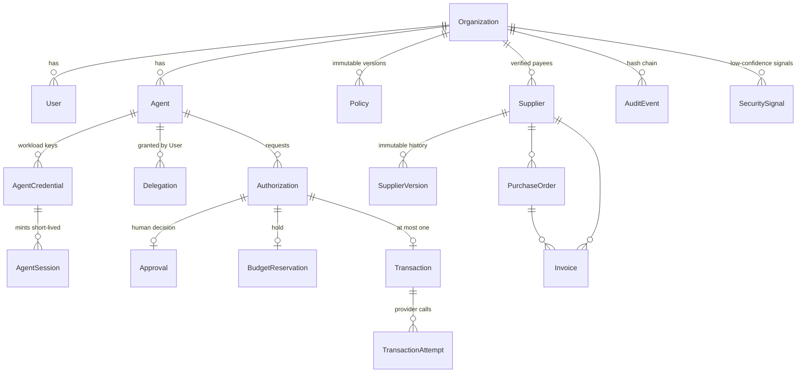

# Database

PostgreSQL is the single source of truth for authority, budgets and payment state. Schema:
[`apps/api/prisma/schema.prisma`](../apps/api/prisma/schema.prisma). Migrations:
[`apps/api/prisma/migrations`](../apps/api/prisma/migrations) (`init`, `hardening`).

## Entities



Sandbox-only tables: `SandboxProviderPayment` (the simulated provider's own ledger) and `SandboxFault` (fault queue).

## Conventions

- IDs: prefixed random 128-bit hex (`agt_…`, `ags_…`, `auth_…`).
- Money: `BIGINT` minor units (cents). Never floating point.
- Every tenant row has `organizationId`; every query filters by the authenticated organization.

## Integrity constraints

| Constraint | Purpose |
|---|---|
| `Authorization (agentId, idempotencyKey)` unique | Safe retries |
| `Transaction.authorizationId` unique, `Transaction.providerIdempotencyKey` unique | At most one payment per authorization |
| `Invoice (organizationId, supplierId, invoiceNumber)` unique | No duplicate invoices |
| Partial unique `BudgetReservation(invoiceId) WHERE status='active'` | One live hold per invoice |
| Partial unique `Policy(organizationId) WHERE status='active'` | One active policy |
| `SupplierVersion (supplierId, version)` unique | Gap-free supplier history |
| `AuditEvent (organizationId, sequence)` unique + UPDATE/DELETE triggers | Append-only ordered evidence |
| CHECK constraints | Positive amounts; delegation limits; `consumed` ⇔ `consumedAt` |

## State

| Table | States |
|---|---|
| Authorization | `allowed`, `pending_review`, `denied`, `rejected`, `consumed`, `expired`, `invalidated` |
| BudgetReservation | `active`, `consumed`, `released` |
| Invoice | `open`, `processing`, `paid`, `void` |
| Transaction | `executing`, `succeeded`, `failed`, `unknown`, `reconciliation_required` |

## Locking protocol

READ COMMITTED with explicit `SELECT … FOR UPDATE`:

```
Spending path:   Authorization → Agent → PurchaseOrder → Invoice → AuditChainHead
Supplier change: Supplier → Authorization rows (invalidation) → AuditChainHead
```

No transaction locks an Authorization row and then a Supplier row, so the two paths can't deadlock.
Reconciliation uses a short **lease** (`Transaction.leaseUntil`) instead of holding locks across provider calls,
and applies outcomes with conditional updates (exactly once).
