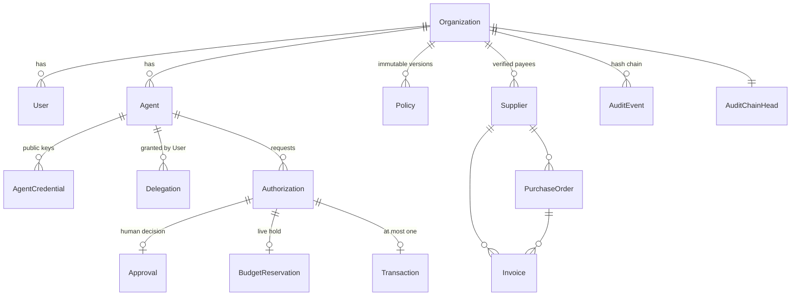

# Database

PostgreSQL is the single source of truth for authority, budgets and transaction state. Schema:
[`apps/api/prisma/schema.prisma`](../apps/api/prisma/schema.prisma). Migrations:
[`apps/api/prisma/migrations`](../apps/api/prisma/migrations).

## Entities



## Conventions

- IDs: prefixed random 128-bit hex (`agt_…`, `auth_…`).
- Money: `BIGINT` minor units (cents). Never floating point.
- Every tenant row has `organizationId`; every query filters by the authenticated organization.

## Integrity constraints

| Constraint | Purpose |
|---|---|
| `Authorization (agentId, idempotencyKey)` unique | Safe retries |
| `Transaction.authorizationId` unique | An authorization executes at most once |
| `Invoice (organizationId, supplierId, invoiceNumber)` unique | No duplicate invoices |
| Partial unique `BudgetReservation(invoiceId) WHERE status='active'` | One live hold per invoice |
| Partial unique `Policy(organizationId) WHERE status='active'` | One active policy |
| `AuditEvent (organizationId, sequence)` unique | Gap-free ordering |
| Triggers on `AuditEvent` | Reject UPDATE and DELETE (append-only) |
| CHECK constraints | Positive amounts; delegation limits sane; `consumed` ⇔ `consumedAt` |

## Locking protocol

All money-affecting transactions run at READ COMMITTED with explicit `SELECT … FOR UPDATE` in this order:

```
Authorization → Agent → PurchaseOrder → Invoice → AuditChainHead
```

- **Agent** lock serializes one agent's decisions → monthly budget is race-free.
- **PurchaseOrder** lock protects PO capacity shared across agents.
- **Invoice** lock + partial unique index prevents double holds and double payment.
- **AuditChainHead** lock (taken last) gives each organization a strictly ordered chain.

Budget and PO usage = `consumed` reservations + `active` reservations that have not expired. Expired holds are
lazily released under the invoice lock.
