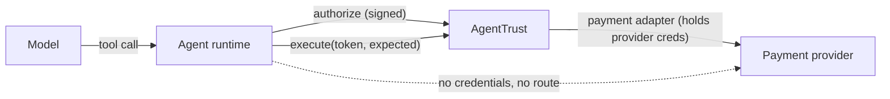

# Integration Guide: putting AgentTrust in front of real agent payments

This guide is for the engineer wiring AgentTrust into an existing agent and payment stack. Do the
[Quickstart](QUICKSTART.md) first (≈ 30 min); this document covers the decisions it skips.

> [!IMPORTANT]
> AgentTrust's guarantee applies **only to payments that go through an AgentTrust-enforced path**. If your agent (or
> any code it can influence) can still reach a payment API with its own credentials, AgentTrust is advisory, and an
> attacker who controls the agent can simply skip it. Section 4 is the part that matters most.

## 1. What AgentTrust checks, and what it doesn't

**Checks, on every payment:**
- **Intent:** the payment matches an *approved* purchase instruction assigned to *this* agent: supplier, line items
  (SKU, quantity, unit price, exact totals), maximum amount, uses remaining, validity window, PO.
- **Payee:** the destination equals the supplier's bank details as **verified by a second administrator**. A changed
  bank account means DENY, never REVIEW-and-click-through.
- **Amount and documents:** invoice exists, belongs to that supplier/PO/instruction, isn't already paid or in flight,
  amounts match exactly, currency matches; three-way match (receipt) when policy requires it.
- **Authority:** agent active, valid delegation (ceiling), budget, and deterministic abuse signals (velocity, budget
  depletion, supplier frequency, recently changed payee).
- **Binding:** the token is bound to the exact records it was evaluated against (supplier version, payee fingerprint,
  instruction version and lines, policy, delegation). Change any of them and the token dies.

**Does not check:**
- Whether the *approved instruction itself* is a good idea. That is the approver's job.
- Payments made outside the enforced path (section 4).
- Real bank-account ownership. The v0.4 account-verification provider is a sandbox stand-in.

## 2. Who holds what

| Component | Holds | Never holds |
|---|---|---|
| **LLM / model** | Tool definitions only | Keys, tokens, bank details it can change, admin credentials |
| **Agent runtime** (your process) | `AgentTrust` client; signs with a workload key via a `workloadSigner` | Payment-provider credentials; admin tokens |
| **Key holder** (sidecar / KMS) | The agent's long-lived Ed25519 workload private key | n/a |
| **Back office / ERP glue** | `AgentTrustAdmin` (human tokens) or an ERP integration credential | Agent keys |
| **AgentTrust gateway** | Payment-provider credentials (through its payment adapter) | n/a |

**Tool design for the model:** give the model *narrow* tools such as `list_my_purchase_instructions()` and
`request_payment(instructionId, invoiceId)`. Have the runtime fill in supplier, payee and amount from trusted records,
then call `authorizations.create`. Even if a prompt-injected invoice persuades the model to supply attacker bank
details, the check against the verified record returns DENY. Narrow tools just make that path unnecessary.

## 3. Where approved instructions come from

An instruction is **independently approved intent**: the agent cannot create, edit, approve or reassign one. Pick
one or more sources:

| Source | How | Approval |
|---|---|---|
| **Humans in AgentTrust** | `AgentTrustAdmin.instructions.create` from your app or back office | `instructions.approve` by a **different** admin or approver, with recent authentication |
| **Your ERP / procurement tool** | An integration (admin creates it with scope `instructions:sync`) calls `POST /v1/integrations/erp/purchase-instructions` | Sync is **not** approval. ERP approval counts only if an admin deliberately grants `instructions:attest_approval` and the payload carries `approvedBy`/`approvedAt`. Otherwise a human approves in AgentTrust. |
| **Your own app** | Your service calls the admin API with a human's token | Same as above |

ERP sync is versioned: stale `externalUpdatedAt` is rejected, and a material change (lines, amount, supplier, agent)
creates a new version and invalidates any live authorization against the old one.

> [!TIP]
> If you have *no* independent approval source today, that's an important finding in its own right. Tell us. A
> lightweight approval flow (for example, Slack approve/deny creating instructions) might be what you actually need.

## 4. Enforcing at the payment boundary

### Pattern A: AgentTrust executes the payment (supported in v0.4)



- The agent runtime has **no payment-provider credentials**. The only way to pay is `transactions.execute`.
- The gateway consumes the token atomically, re-checks the binding, compares `expected`, then calls the provider with
  an idempotency key. Retries reconcile; they never pay twice.
- **v0.4 status:** only the **sandbox** payment adapter exists. A real provider (Stripe, Modern Treasury, Increase, a
  bank API) means implementing the `PaymentAdapter` interface (`execute`, `getStatus`, signed webhooks) in
  `apps/api/src/transactions/payment-adapter.ts`. No real-money adapter ships yet, by decision.

### Pattern B: your payment service verifies and consumes (not built; tell us if you need it)

Many teams already own the code that calls their payment provider. In this pattern that service, not the agent,
would be the enforcement point:

```
agent → AgentTrust: authorize → token
agent → your payment service: "pay invoice X" + token
your payment service → AgentTrust: verify-and-consume(token, exact payment) → OK (single use) or refuse
your payment service → provider: pay
your payment service → AgentTrust: report outcome (accepted / settled / failed …)
```

This is **not implemented in v0.4**. If your architecture needs it, it's the most useful thing you can tell us, and
it would be the headline of the next version.

### Anti-pattern: advisory mode

"The agent calls AgentTrust, and if it says ALLOW, the agent pays with its own Stripe key." This gives a log, not a
control: a compromised agent skips the call. Don't present it to your customers as enforcement.

## 5. Handling decisions

| Decision | Status | What your runtime should do |
|---|---|---|
| **ALLOW** | `allowed` | Execute promptly with `auth.token` (it expires, and it dies if bound records change) |
| **REVIEW** | `pending_review` | Stop and tell the user. A human resolves it in the review queue (`authorizations.list({status:'pending_review'})` → `approve`/`deny`). Approval **re-evaluates every rule**. Approvers need spending authority ≥ amount and recent authentication. Payee/supplier problems are never approvable (`checks[].approvable = false`). Poll `authorizations.get(id)`; a token appears only once it's allowed. |
| **DENY** | `denied` | Don't retry with tweaks. Surface `reasonCodes` to the human. |

## 6. Payment lifecycle and retries

`execute` returns **200** for final states (`settled`, `failed`, `returned`, `reversed`) and **202** while in flight
(`accepted`, `processing`, `unknown`, `reconciliation_required`).

- **Accepted is not paid.** Only `settled` marks the invoice paid.
- On 202, timeouts or network errors: **retry `execute` with the same token**, or poll `transactions.get(id)`.
  **Never request a new authorization to "try again"**: the invoice is in flight and a second authorization is
  denied (`INVOICE_IN_FLIGHT`).
- `returned` / `reversed` payments are never automatically paid again. An admin resolves them explicitly
  (`transactions.resolve`).
- `idempotencyKey` on `authorizations.create` makes the *request* safe to retry: the same key returns the same
  authorization.

## 7. Errors: fail closed

Every SDK raises `AgentTrustError` (`status`, `code`, `message`) for any non-2xx response, network failure or
unreadable response. **Treat every error as "not authorized"** and never fall back to paying. Common codes:
`UNAUTHENTICATED`, `ROLE_REQUIRED`, `SEPARATION_OF_DUTIES`, `TRANSACTION_MISMATCH`, `RATE_LIMITED`, `INVALID_REQUEST`.

## 8. Keys and credentials

- **Agent:** register only the public key. In production pass `workloadSigner` (TypeScript) or `workload_signer`
  (Python), a function from bytes to a 64-byte Ed25519 signature backed by a sidecar or KMS. The SDK then keeps only
  15-minute session keys in memory. Rotate with `sessions.rotate()`; kill an agent with `agents.revoke`.
- **Humans:** the sandbox uses development tokens. Production needs your identity provider (OIDC with MFA). That
  isn't wired up yet.
- **ERP:** v0.4 integrations use a static scoped secret (`itk_…`), shown once and stored hashed. Production should
  use OAuth client credentials or mTLS.

## 9. Latency

No load testing yet. One **local lower bound** (sandbox container + Postgres on one laptop, one sequential client,
simulated provider, 55 measured requests after warm-up, v0.4.0):

| Call | p50 | p95 |
|---|---|---|
| `authorizations.create` (full rule evaluation, ALLOW path) | 12 ms | 24 ms |
| `transactions.execute` (token consume + binding re-check + provider call) | 13 ms | 32 ms |

Expect more in practice: the network round trip to the hosted sandbox, real provider latency, and concurrency. Each
call is one round trip and one database transaction. If your latency budget is tight (for example, card
authorization windows), tell us your number. The measurement script is `scripts/bench/latency.mts` (ask us for a copy).

## 10. Before production (not done in v0.4)

Real payment adapter · identity provider for humans · KMS-backed platform signing key and secrets manager · external
immutable audit storage (S3 Object Lock adapter not implemented) · real account-ownership verification ·
independent security testing · contractual and legal review. The sandbox is for evaluation only.
