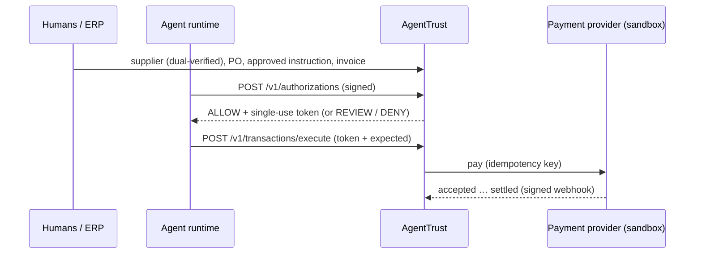

# Quickstart: your first authorized agent payment (≈ 20–30 minutes)

You'll go from nothing to a **settled sandbox payment** made by an AI agent through AgentTrust, then watch the gateway
block two attacks. Sandbox only: no real money moves.

**What you need:** the sandbox URL (`$BASE_URL` below), plus Node ≥ 18.17 *or* Python ≥ 3.9.

> [!NOTE]
> The sandbox measures how long this takes (signup → first settled payment) so we can improve it. You can see your
> own timings with `GET /v1/sandbox/progress`.

## 0. Install the SDK (2 min)

```bash
# TypeScript / Node
npm install $BASE_URL/downloads/agenttrust-sdk-0.4.0.tgz

# Python
pip install $BASE_URL/downloads/agenttrust-0.4.0-py3-none-any.whl
```

## The idea in one paragraph

An agent's spending limit says *how much* it may spend. AgentTrust also checks *what* it's paying for: every payment
must match a **purchase instruction** that a human (or your ERP) approved independently, naming the agent, supplier,
line items, prices, maximum amount and expiry. It must also go to the **verified bank account** of that supplier and
pass policy. The agent gets a single-use token only on **ALLOW**, and the only way to move money is the **gateway**,
which re-checks everything at execution time.



## 1. Create a sandbox (1 min)

<table><tr><td>

```ts
import { AgentTrustSandbox } from '@agenttrust/sdk';
const { sandbox, account } = await AgentTrustSandbox.signup({
  baseUrl: BASE_URL, organizationName: 'Acme', email: 'you@acme.com',
});
console.log(account.sandboxKey); // save it: shown once
const admin = sandbox.as('admin');
const approver = sandbox.as('approver');
```

</td><td>

```python
from agenttrust import AgentTrustSandbox
sandbox, account = AgentTrustSandbox.signup(
    BASE_URL, "Acme", "you@acme.com")
print(account["sandboxKey"])  # save it: shown once
admin = sandbox.as_persona("admin")
approver = sandbox.as_persona("approver")
```

</td></tr></table>

You get three personas so you can do dual control alone: **admin** (you), **verifier** (a second admin), and
**approver**. The sandbox gives one developer all three; it doesn't relax the rules. The same person still can't
both enter and verify a bank account, or both request and approve an instruction.

## 2. Add a supplier with verified bank details (2 min)

```ts
const { supplierId } = await sandbox.createVerifiedSupplier('Northwind Industrial Supply');
```

Under the hood, `admin` runs `suppliers.create({ name, paymentDestination })`, then `verifier` runs
`suppliers.verifyPaymentDestination(id, { evidence, confirmedLast4 })`. In production, `evidence` records how
ownership was confirmed out of band (for example, a call to the number on the signed contract).

## 3. Register the agent and set its ceiling (3 min)

```ts
const agent = await sandbox.registerAgent('Procurement agent');   // agent.client = the agent runtime's client
await approver.delegations.create({
  agentId: agent.agentId, actions: ['purchase'], currency: 'USD',
  maxTransactionCents: 100_000, monthlyLimitCents: 500_000,
  expiresAt: new Date(Date.now() + 30 * 864e5).toISOString(),
});
```

`registerAgent` generates an Ed25519 key in your process and registers the **public** key. That's fine for the
sandbox. In production, generate the key in a sidecar or KMS and pass a `workloadSigner`, so that nothing the LLM's
tools can reach ever holds the key. The workload key only mints 15-minute session keys; every request is signed.

## 4. Say what the business actually wants bought (5 min)

```ts
const po = await admin.purchaseOrders.create({ supplierId, externalReference: 'PO-1001', approvedAmountCents: 48_000, currency: 'USD' });
const lines = [{ lineNumber: 1, sku: 'DRL-100', description: 'Cordless drill', quantity: '4', unitPriceCents: 12_000 }];
const instruction = await admin.instructions.create({
  agentId: agent.agentId, supplierId, purchaseOrderId: po.id, fulfillmentType: 'physical_goods',
  currency: 'USD', lines, maxUses: 1, expiresAt: new Date(Date.now() + 7 * 864e5).toISOString(),
});
await approver.instructions.approve(instruction.id);          // a different person approves
const invoice = await admin.invoices.create({
  supplierId, purchaseOrderId: po.id, purchaseInstructionId: instruction.id, invoiceNumber: 'INV-77',
  amountCents: 48_000, currency: 'USD', lines: lines.map((l) => ({ ...l, instructionLineNumber: 1 })),
});
```

Money is always integer **cents**, and quantities are exact decimal **strings**. In production, instructions and
invoices usually arrive from your ERP or procurement tool (see the [Integration Guide](INTEGRATION_GUIDE.md#3-where-approved-instructions-come-from)).

## 5. The agent asks before paying (3 min)

```ts
const auth = await agent.client.authorizations.create({
  idempotencyKey: 'buy-drills-0001', action: 'purchase',
  supplierId, payee: { type: 'us_ach', routingNumber: '021000021', accountNumber: '4000123456' },
  amountCents: 48_000, currency: 'USD',
  purchaseOrderId: po.id, invoiceId: invoice.id, purchaseInstructionId: instruction.id,
});
auth.decision;   // 'ALLOW' | 'REVIEW' | 'DENY'
auth.checks;     // every check with outcome + reason code
auth.token;      // present only on ALLOW: single use, short lived
```

Try changing the `payee` account number, `amountCents`, or a line quantity. You'll get **DENY** with reason codes
such as `PAYEE_MISMATCH`, `AMOUNT_EXCEEDS_INSTRUCTION` or `LINE_QUANTITY_EXCEEDS_INSTRUCTION`, and no token.

## 6. Pay through the gateway (3 min)

```ts
const tx = await agent.client.transactions.execute({
  token: auth.token!,
  expected: { supplierId, amountCents: 48_000, currency: 'USD', purchaseOrderId: po.id, invoiceId: invoice.id },
});
tx.status;  // 'accepted': the provider took it. This is NOT paid yet.

await sandbox.advancePayment(tx.id, 'settled');   // sandbox: play the provider (signed webhook)
(await admin.invoices.get(invoice.id)).status;    // 'paid': only now
```

`expected` is what *you* believe you're paying. If it differs from the authorization, the gateway refuses.
Re-running `execute` with the same token never pays twice: it reconciles to the same transaction.

## 7. Check your work

```ts
await sandbox.progress();      // { completed: true, minutesToFirstSettledPayment: … }
await admin.audit.verify();    // { valid: true }: tamper-evident audit chain over everything you just did
```

**Complete runnable versions:** [`examples/quickstart-typescript/quickstart.ts`](../../examples/quickstart-typescript/quickstart.ts)
and [`examples/quickstart-python/quickstart.py`](../../examples/quickstart-python/quickstart.py). Both are run in CI.

## Next

- [Integration Guide](INTEGRATION_GUIDE.md): putting AgentTrust in front of your real payment path.
- [API reference](openapi.yaml) (served at `$BASE_URL/docs`).
- Common errors: `401 UNAUTHENTICATED` (wrong key, or clock skew over 5 min), `403 ROLE_REQUIRED` (wrong persona),
  `403` on verify (the same admin who entered the bank details), `400 INVALID_REQUEST` (unknown or missing fields;
  bodies are strict).
